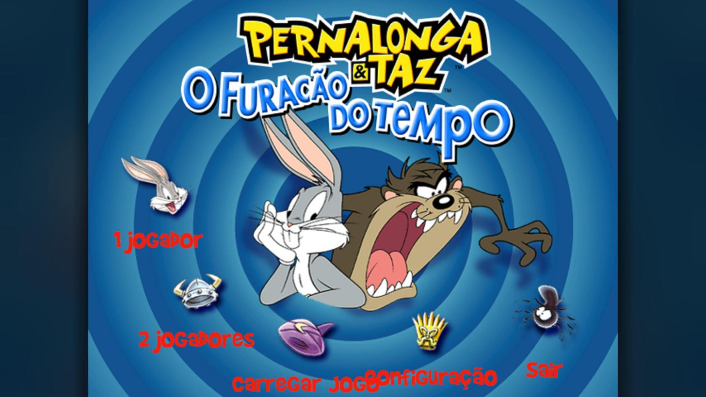
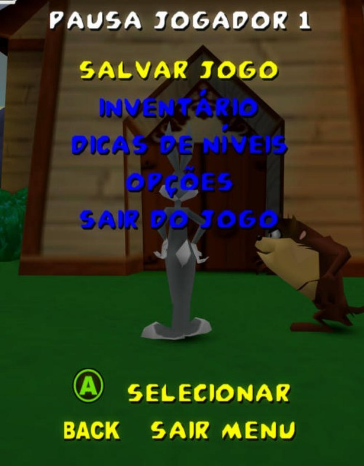
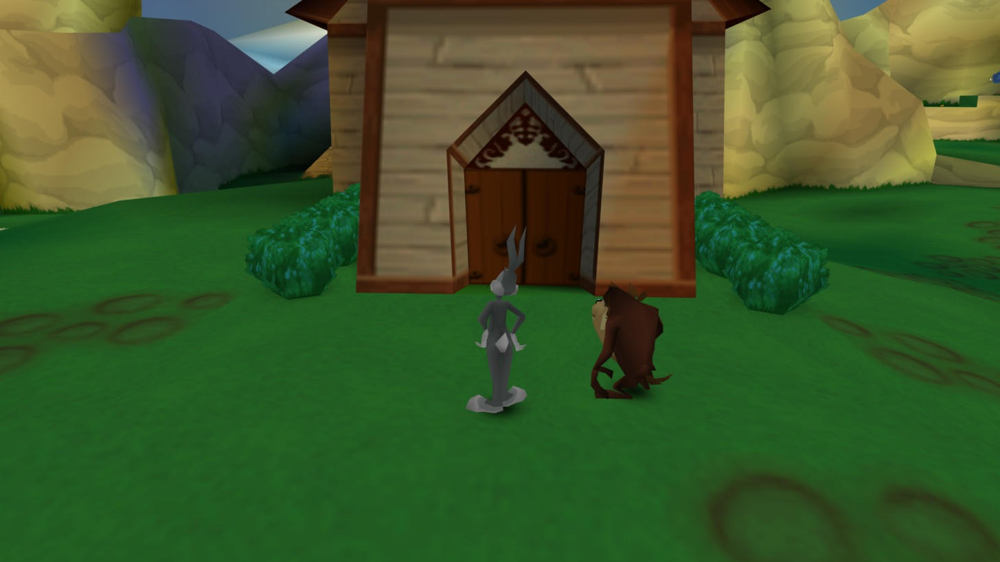
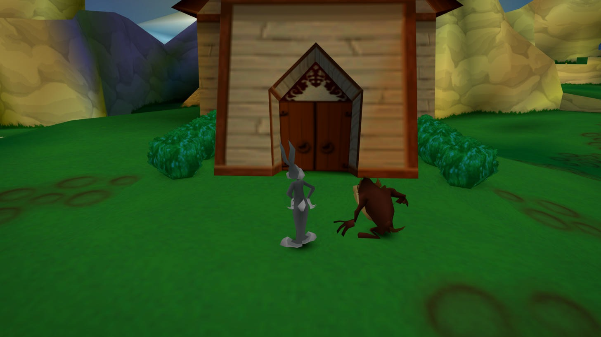
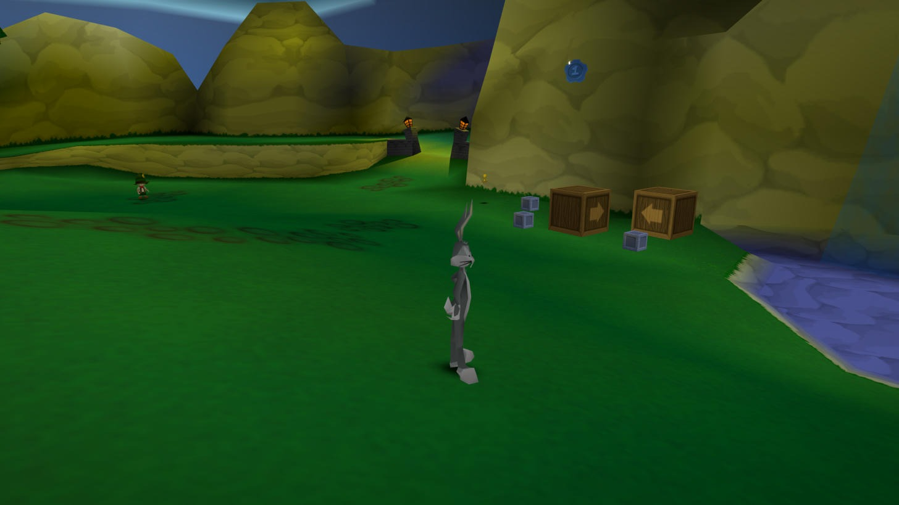

# BBLIT2 Fix — Pernalonga e Taz: O Furacão do Tempo

Correções e melhorias para a versão de PC de **Pernalonga e Taz: O Furacão do Tempo** (*Bugs Bunny & Taz: Time Busters*, Infogrames, 2000/2001) rodar bem no Windows 10/11.

É um único `dinput.dll` mais um `bblit2fix.ini`. **Nenhum arquivo do jogo é alterado**: as correções são aplicadas em memória quando o jogo abre. Apague o `dinput.dll` e o jogo volta a ser o original.

Inspirado no [BBLIT Remaster](https://github.com/InLineR495/BBLIT-Remaster) (para *Lost in Time*, do mesmo motor), mas é um projeto separado. O executável do *Furacão do Tempo* tem outra estrutura e nenhum endereço em comum com o do *Lost in Time*.

## Vídeo

[](https://youtu.be/U_6izGr0n9c)

Teaser de 55 segundos no YouTube: menus em 16:9, antes e depois com zoom nas bordas, nas letras e nos botões do controle, e o pacote HD dos menus.

## Antes e depois

Capturas no próprio jogo, em 2560×1440 (v0.9 a v0.12).

| | Antes | Depois |
|---|---|---|
| **Tela inicial** (v0.12, 16:9 de verdade) |  |  |
| **Pausa com o controle conectado** (v0.10: fonte HD e botões do Xbox) |  |  |
| **Efeitos de imagem** (mesmo quadro) |  |  |
| **Itens surgindo do nada** (mesmo lugar; o item azul à esquerda) |  |  |
| **HUD no widescreen** (ícones 3D x contadores) |  |  |

Resumo em imagens: [`docs/comparacao_v010.png`](docs/comparacao_v010.png) e [`docs/comparacao_v09.png`](docs/comparacao_v09.png). O histórico de versões está em [`CHANGELOG.md`](CHANGELOG.md).

## O que muda

**Vídeo**
- **Tela cheia na resolução do monitor** (testado em 2560×1440), sem trocar o modo de vídeo e sem exigir área de trabalho em 16 bits. O original não abre no Windows moderno ("You must set your desktop bit depth to 16bit").
- **Widescreen de verdade (Hor+)**: em 16:9 o jogo mostra mais cenário dos lados, sem esticar. Menus e telas 2D continuam em 4:3 no centro, ampliados com suavização.
- **Antisserrilhado**: MSAA 4× + supersampling 2× (renderização interna em 2× a resolução da tela).
- **Mipmaps e filtro anisotrópico 16×** nas texturas filtradas: menos "chuvisco" ao longe.
- **Distância de visão** até 4× a original (limitada pelo tamanho da tabela de ordenação do motor) e buffers de polígonos 4× maiores.
- **Menos coisas "brotando" do nada**: itens, personagens e objetos aparecem de 2× mais longe (configurável até 4×), e os modelos mantêm o detalhe máximo até 4× mais longe antes de trocar pelos simplificados (LOD).
- **Nada some nas laterais do widescreen**: o teste de visibilidade dos objetos foi ajustado para a tela larga.
- **HUD alinhado**: no widescreen, os ícones 3D (cenoura, moeda de ouro) ficam junto dos contadores, no 4:3 central.
- **Pós-processamento opcional**: brilho suave nas luzes (bloom), nitidez adaptativa (CAS), saturação, contraste e vinheta. Tudo regulável ou desligável no ini.
- **Letras e HUD em HD**: a fonte do jogo, os números, ícones e desenhos da pausa são redesenhados em 4× com contorno liso (xBR, feito na hora pelo mod a partir das texturas do próprio jogo; nenhum arquivo de textura é distribuído). As texturas são reconhecidas pelo desenho, e não pelas cores, então funciona com qualquer ajuste de "Brilho" do menu Vídeo.
- **Menus 2D em 16:9 de verdade**: a tela inicial, as de configuração, a de carregar e as aberturas ocupam a tela inteira sem esticar nada. O mod mede o fundo de anéis do próprio jogo (centro, achatamento e a cor de cada anel) e continua o desenho até as bordas; nas aberturas, a cor lisa do fundo. Cada fundo fica pronto assim que o jogo carrega a imagem, então ao trocar de menu a tela 16:9 aparece inteira de uma vez. Os textos são desenhados direto na resolução do monitor, e nomes que ficavam encavalados em português ("Carregar Jogo" em cima de "Configuração") são desenhados um pouco mais estreitos.
- **Pacote HD dos menus (opcional)**: o script `tools/hd_menu/make_pack.py` amplia 4× os ícones, logos e fundos dos menus com o Real-ESRGAN, a partir dos arquivos do seu jogo, e pode deixar a tela inicial no mesmo azul escuro da tela de configuração. O mod usa a pasta `bin\hd` sozinho e mistura cada ícone ao fundo pronto, sem retângulo em volta. Veja [tools/hd_menu](tools/hd_menu/README.md).
- **Telas Vídeo e Controles** do menu voltam a mostrar todos os itens (com a imagem ampliada, o jogo só redesenhava um item de cada vez).
- **Qualidade automática**: se o PC não segurar 30 quadros por segundo, o mod reduz o antisserrilhado sozinho.

**Controle**
- **Controle Xbox/XInput** convertido nas teclas que você configurou no jogo (o jogo lê o teclado pelo DirectInput; o controle é somado ali).
- **Controle nos menus do início** (1 jogador, Carregar jogo, Configuração): o jogo só deixa usar esses menus com o mouse. Com o controle, o direcional ou o analógico pula de item em item (o item fica realçado como se o mouse estivesse em cima), A ou Start confirma e B volta. Na tela de carregar, A no jogo salvo já leva o foco para "Carregar" (`menu_navigation`).
- **Botões do Xbox nas dicas**: com o controle conectado, as dicas e menus do jogo mostram Ⓐ Ⓑ Ⓧ Ⓨ, LB, RB, BACK e Menu no lugar das teclas, e voltam às teclas na hora em que o controle é desconectado (`button_prompts`).
- Câmera no analógico direito e em LT/RT, com inversão configurável.

| Controle | Ação |
|---|---|
| Analógico esquerdo / direcional | Andar |
| A | Pular (e Enter nos menus) |
| X | Chutar |
| B | Orelhas / escapar |
| Y | Ação |
| LB | Chamar o amigo |
| RB | Trocar a câmera |
| LT / RT ou analógico direito | Girar a câmera |
| Clique no analógico direito | Visão em primeira pessoa |
| Start | Pausa (Esc) |
| Back | Menu anterior (F4) |

**Outros**
- **Idioma detectado pelo CD**: a versão brasileira só tem as falas em `SPEECH\05`; se o registro estiver em outro idioma, o jogo fica em inglês e **sem vozes**. Agora menus e falas saem em português.
- **Jogo em segundo plano**: clicar no outro monitor ou em outra janela não derruba mais o jogo (o original destrói e recria a janela e o OpenGL a cada perda de foco). Alt+Tab funciona.
- Log de diagnóstico em `bin\bblit2fix.log`.

**Para rodar em qualquer PC**
- Funciona com a pasta do jogo copiada para qualquer lugar, mesmo em um PC onde o jogo nunca foi instalado (sem a chave no registro). O jogo passa a usar a pasta de onde está rodando: `config.pc` e saves ficam na própria pasta `bin`.
- Já na primeira execução o jogo abre na resolução do monitor (a resolução é ajustada em memória, logo depois que o jogo lê o `config.pc`).
- Escala do Windows acima de 100% (notebooks costumam vir com 125% ou 150%) não reduz mais a resolução.
- Monitores 16:9, 16:10 e 21:9 em widescreen; monitores 5:4 ficam em 4:3 com faixas em cima e embaixo.
- Se a placa recusar alguma coisa (memória, limite de tamanho, falta de shaders), o mod tenta uma configuração mais leve, até desligar o recurso, e registra o que fez no log. Em monitores 4K o supersampling fica desligado (a imagem já é nítida e seria pesado demais).
- Se uma execução travar na abertura, o jogo cai sozinho para Direct3D/software na vez seguinte; o mod devolve o OpenGL (`force_opengl`), de que as melhorias dependem.

## Requisitos

- *Pernalonga e Taz: O Furacão do Tempo* para PC, versão brasileira, com o `bblit2.exe` original:
  - 880 640 bytes
  - SHA-256 `64427e4a7c24ffeb00a43aed00749d77b2a1b09525fa6fdc9bf9a452950dd5c3`
  
  Com qualquer outro `bblit2.exe`, o mod fica desligado (só o proxy do DirectInput continua ativo).
- O CD (ou a ISO montada): o jogo lê as fases e as falas do disco.
- Placa de vídeo com OpenGL. Antisserrilhado e efeitos pedem OpenGL 3.0 ou superior (qualquer placa ou vídeo integrado dos últimos ~12 anos); sem isso, o mod desliga só esses recursos. Testado: NVIDIA RTX 3080, driver 616.92.

## Instalação

1. Instale o jogo normalmente (ou copie a pasta instalada para um lugar fora de `Arquivos de Programas`, como `C:\BBLIT2`).
2. Copie `dist/dinput.dll` e `dist/bblit2fix.ini` deste repositório para a pasta `bin` do jogo, ao lado de `bblit2.exe`.
3. Monte a ISO do jogo (duplo clique) ou coloque o CD.
4. Abra `bin\bblit2.exe`.
5. No menu Configuração → Vídeo do jogo, deixe o **Nível de Detalhes em Alto** e o **Brilho perto do meio da barra** (o padrão do jogo).

Para desinstalar, apague `dinput.dll` (e, se quiser, `bblit2fix.ini` e `bblit2fix.log`).

## Configuração (`bblit2fix.ini`)

| Chave | Seção | Padrão | O que faz |
|---|---|---|---|
| `aspect` | `[video]` | 2 | 2 = widescreen Hor+, 1 = 4:3 com barras, 0 = esticado |
| `msaa` | `[video]` | 4 | Antisserrilhado das bordas: 0, 2, 4, 8 |
| `supersampling` | `[video]` | 2 | Renderização interna N× maior (1 = desligado, até 4) |
| `mipmaps` | `[video]` | 1 | Mipmaps nas texturas filtradas |
| `anisotropy` | `[video]` | 16 | Filtro anisotrópico |
| `draw_distance` | `[video]` | 400 | Distância de visão, % da original (50–400) |
| `object_distance` | `[video]` | 200 | Distância em que itens e personagens aparecem, % da original (100–400) |
| `lod_distance` | `[video]` | 400 | Distância até a troca pelos modelos simplificados, % da original (100–1000) |
| `auto_quality` | `[video]` | 1 | Reduz o antisserrilhado se o PC não segurar 30 fps |
| `force_opengl` | `[video]` | 1 | Volta para OpenGL se o jogo tiver caído para Direct3D/software |
| `background` | `[video]` | 1 | Continua rodando sem foco (0 = comportamento original) |
| `native_res` | `[video]` | 1 | Grava no `config.pc` a resolução certa para o monitor |
| `vsync` | `[video]` | 1 | Sincronia vertical |
| `hd_textures` | `[video]` | 1 | Fonte, HUD e desenhos da pausa em 4× (xBR) |
| `menu_fill` | `[video]` | 3 | Telas 2D: 3 = 16:9 com o fundo continuando até as bordas, 1 = laterais desfocadas, 2 = esticadas, 0 = barras pretas |
| `menu_hd` | `[video]` | 1 | Usa o pacote HD dos menus (pasta `hd`), se existir |
| `hires_menu` | `[video]` | 1 | Textos dos menus 2D na resolução do monitor |
| `button_prompts` | `[pad]` | 2 | Dicas com o controle conectado: 2 = ícones do Xbox, 1 = nomes (A, B, LB…), 0 = teclas |
| `menu_navigation` | `[pad]` | 1 | Controle nos menus do início (direcional/analógico, A/Start, B volta) |
| `xinput` | `[pad]` | 1 | Controle XInput |
| `invert_camera_stick` | `[pad]` | 1 | Inverte o giro da câmera no analógico direito |
| `invert_camera_triggers` | `[pad]` | 1 | Inverte o giro da câmera em LT/RT |
| `deadzone` | `[pad]` | 30 | Zona morta do analógico esquerdo, % |
| `language` | `[game]` | -1 | -1 = pelas falas do CD; 0 = inglês … 5 = português |
| `enabled` | `[postfx]` | 1 | Liga os efeitos de imagem (0 desliga todos) |
| `bloom` | `[postfx]` | 25 | Brilho suave em volta das partes claras (0–100) |
| `bloom_threshold` | `[postfx]` | 70 | A partir de que claridade o bloom age (0–100) |
| `sharpen` | `[postfx]` | 40 | Nitidez adaptativa (CAS), 0–100 |
| `saturation` | `[postfx]` | 110 | Saturação das cores, % |
| `contrast` | `[postfx]` | 105 | Contraste, % |
| `vignette` | `[postfx]` | 20 | Cantos levemente escurecidos (0–100) |

**F12** salva uma captura da tela do jogo, na resolução do monitor e sem perdas, em `bin\capturas\`.

Com `debug=1` (seção `[fix]`), algumas teclas ajudam a comparar: **F9** alterna entre as distâncias de objetos e LOD originais e as do mod, **F11** liga e desliga os efeitos de imagem e **F8** finge que o controle foi desconectado/conectado (para testar as dicas). `dump_textures=1` grava as texturas carregadas em `texdump.bin`, com a assinatura usada pela lista HD; uma lista extra pode ir em `bin\bblit2fix_hd.txt` (uma assinatura hexadecimal por linha).

## Limitações conhecidas

- O jogo continua a 30 quadros por segundo (a lógica é presa a 30 Hz; a interpolação de quadros do BBLIT Remaster ainda não foi portada). Para ver 60 na tela, dá para usar geração de quadros externa, como o Lossless Scaling, que funciona com janelas sem borda.
- DLSS e ray tracing não se aplicam: o jogo usa OpenGL 1.x e projeta a geometria na CPU, como o PlayStation; a placa só recebe triângulos 2D, sem vetores de movimento nem profundidade.
- Objetos muito distantes ainda obedecem ao limite de ativação do motor (`object_distance`, até 4× o original).
- Só a versão brasileira do `bblit2.exe` foi mapeada.
- O "Brilho" do menu Vídeo do jogo realça só as cores das texturas (pele pintada nos modelos não muda). Acima do meio da barra (~43%, o padrão do jogo) os rostos ficam manchados, como a pele da Vovó de uma cor e as sobrancelhas de outra. Para cores mais vivas, prefira `saturation`/`contrast` em `[postfx]`, que valem para a imagem inteira.

## Como funciona (resumo técnico)

- O jogo importa `DINPUT.dll`, que não é uma "KnownDLL": o Windows carrega o `dinput.dll` da pasta do jogo, que repassa as chamadas para o `dinput.dll` do sistema e, ao carregar, instala os ganchos.
- Ganchos de IAT (`GetProcAddress`, `ChangeDisplaySettingsA`, `EnumDisplaySettingsA`, `GetDeviceCaps`, `CreateWindowExA`, funções GDI…) e da tabela de funções OpenGL que o jogo monta via `GetProcAddress`.
- Widescreen: a função de tela do motor (`0x405ef0`, chamada com a base 512×240 do PlayStation) roda com uma largura 4:3, o que mantém as escalas, e depois os limites de tela e de recorte recebem a largura real.
- Distância de visão: `0x409840(a, b)` define o corte de profundidade de cada parte do cenário conforme o Nível de Detalhes.
- Controle: gancho no `IDirectInputDevice::GetDeviceState` do teclado (vtable) somando as teclas do controle (códigos DIK lidos do `config.pc`).
- Antisserrilhado: o jogo desenha num framebuffer multisample (FBO) separado, que é resolvido e reduzido na troca de quadros, sem mexer no formato de pixel da janela (que o jogo recusa).
- Pós-processamento: a imagem resolvida vira textura e passa por shaders GLSL (redução do supersampling, bloom em 1/4 da tela com desfoque gaussiano separável, e um passe final com CAS, cor e vinheta).
- Objetos: a lista de visão (`0x45eee0`) desliga cada objeto além do alcance `+0x76` medido da câmera (`0x45f36b`) e troca os modelos por LOD conforme `+0x121`/`+0x122` × 256 (`0x45f3f2`). Os dois ganchos multiplicam essas distâncias; no widescreen, os três testes de frustum recebem o x corrigido para a tela larga.
- HUD: `0x404d40` posiciona os modelos 3D presos à tela em x × largura / 512; no widescreen essa conta passa a usar a largura 4:3.
- `config.pc`: gancho logo após a leitura (`0x415e10`) para ajustar resolução e renderizador na memória; o jogo grava o arquivo sozinho em seguida.
- Texturas HD: no `glTexImage2D` (e no `glTexSubImage2D` que preenche a textura inteira), cada textura recebe uma assinatura do desenho: alfa e número de cada cor na ordem em que aparece, sem as cores em si. O ajuste de cor do menu Vídeo (matiz/brilho/saturação aplicados às paletas em `0x407d30`) muda as cores, mas não o desenho; um gancho nessa função impede que duas cores diferentes virem uma só. As que estão na lista são ampliadas em 4× por xBR (regras do Hyllian, implementação própria) e enviadas no lugar; atualizações parciais seguintes vão na posição ×4. Os nomes de textura são esquecidos ao serem apagados ou reenviados, e cada pedaço confere o tamanho real da textura.
- Botões do Xbox: o texto do jogo pede o caractere da tecla na operação `0x14` (`0x467667`); com o controle conectado, o mod devolve o caractere de um símbolo do PlayStation que existe na fonte e não é usado no PC (✕ ○ □ △ L1 R1 "START"), e a textura desse símbolo é trocada por um ícone desenhado na hora. Enter e Esc têm as duas versões guardadas e trocam ao conectar/desconectar.
- Controle nos menus do início: cada tela é uma lista de painéis (`[0x639324 + 36 × menu]`, encadeados em `+0x18`) com itens de tipo, retângulo (640×480) e estado; o mod escolhe o vizinho na direção apertada, põe o cursor no centro dele (o jogo realça como faria com o mouse) e manda o clique. As linhas da lista de jogos salvos têm 22 pixels.
- Menus 2D: as chamadas GDI do menu são desenhadas numa tela virtual na resolução do monitor (fontes escaladas, recorte do `BeginPaint` respeitado) e copiadas para a janela. Cada bitmap 640×480 que o jogo carrega (`LoadImageA`) é medido na hora: um modelo de anéis elípticos (centro e achatamento por busca, com uma segunda passada que ignora painéis e ícones desenhados na própria imagem; cor de cada raio pela mediana; período dos anéis por autocorrelação para ir além do último raio medido) ou cor lisa. Com isso o mod monta uma imagem do tamanho da janela (o bitmap ampliado no meio e os anéis continuando nas laterais) e, quando o jogo desenha o fundo, copia dessa imagem: a tela 16:9 sai inteira de uma vez. Ficam prontas no máximo 3 dessas imagens e elas são liberadas durante as fases. Fundos que não são reconhecidos ficam com as laterais desfocadas. Com o pacote HD, o meio vem da imagem 4× (`hd\<nome>.bmp`), o perfil dos anéis das laterais é medido de novo nela (faixas 4× mais finas, para as bordas ficarem tão nítidas quanto o meio), e `hd\1x\<nome>.bmp` substitui a imagem original na medição e nos ícones. Os ícones do jogo trazem um pedaço do fundo desenhado junto: o mod compara o ícone com o fundo na posição em que ele é desenhado e, onde é só fundo, usa a imagem pronta.

## Compilação

Precisa do MinGW-w64 para i686:

```sh
# Ubuntu/Debian: sudo apt install gcc-mingw-w64-i686
./build.sh        # gera build/dinput.dll
```

A `dinput.dll` pronta de cada versão fica em `dist/`.

## Licença

MIT, ver `LICENSE`. *Pernalonga*, *Taz* e *Looney Tunes* são marcas da Warner Bros.; o jogo é da Infogrames/Behaviour Interactive. Este repositório não contém nenhum arquivo do jogo: você precisa ter o seu.
