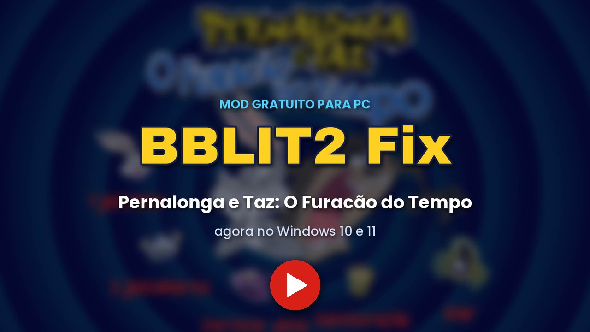
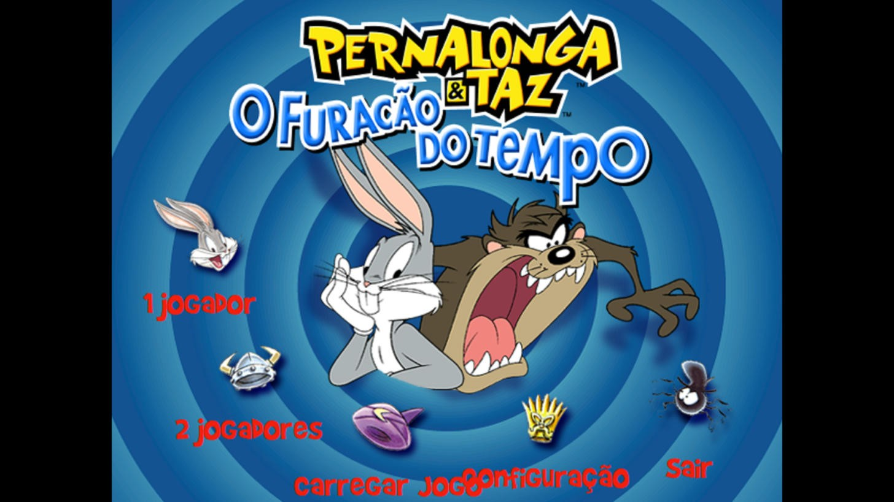
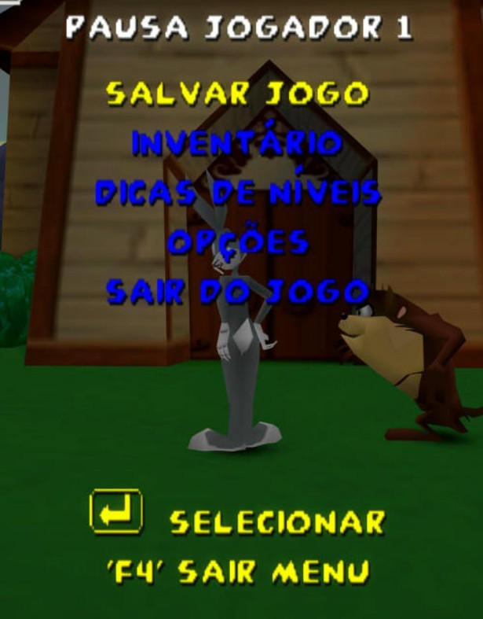
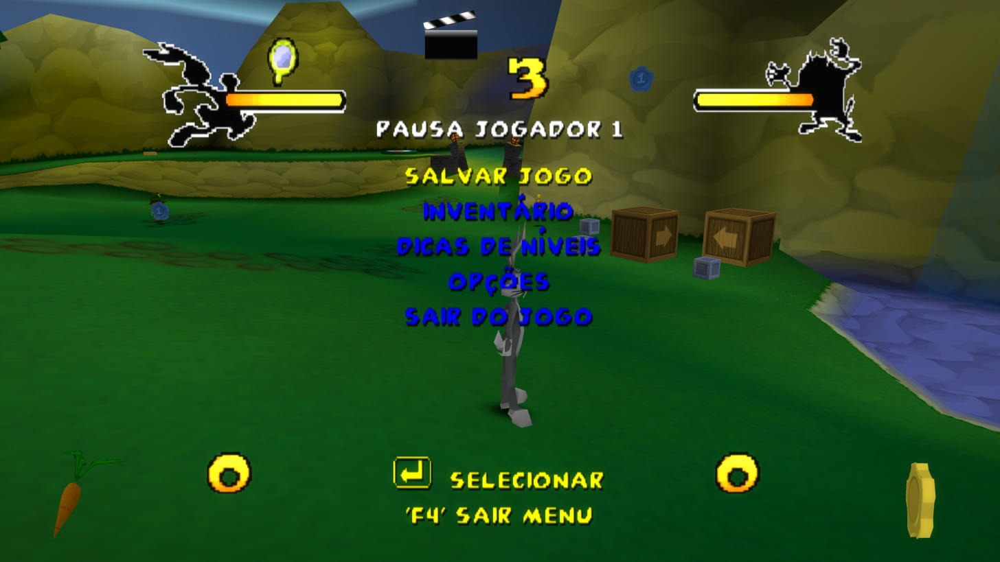
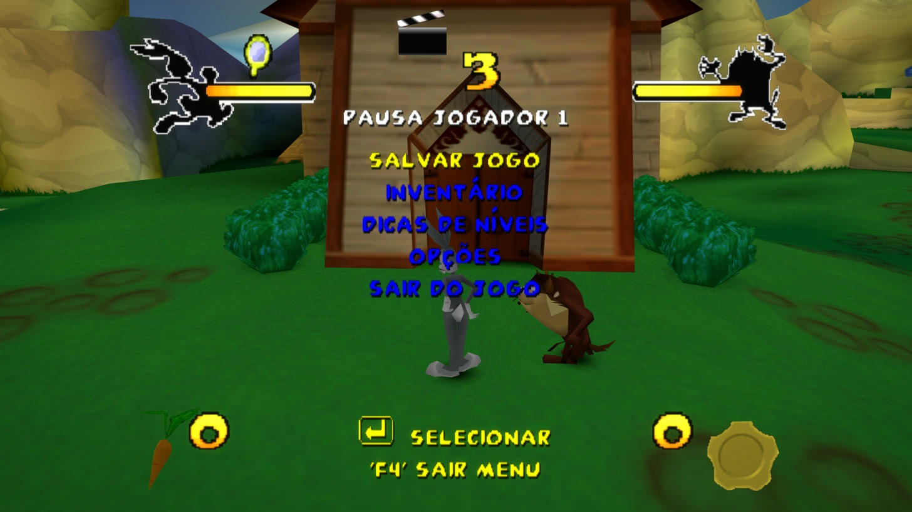
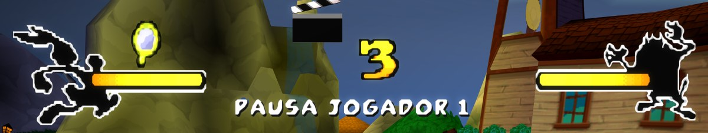
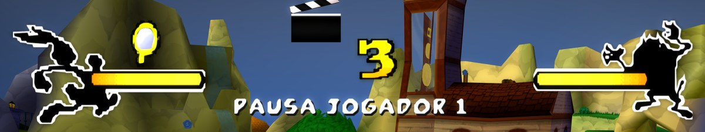

# BBLIT2 Fix — Pernalonga e Taz: O Furacão do Tempo

Criei este projeto inicialmente para mim mesmo, por gostar muito de **Pernalonga e Taz: O Furacão do Tempo** (*Bugs Bunny & Taz: Time Busters*, Infogrames, 2000/2001), e decidi disponibilizá-lo para ajudar outras pessoas a rodarem a versão de PC sem problemas no Windows 10 e 11.

## Como funciona

A solução consiste em apenas dois arquivos: `dinput.dll` e `bblit2fix.ini`. Nenhum arquivo original do jogo é modificado: todas as correções e melhorias são aplicadas diretamente na memória quando o jogo abre. Se quiser voltar ao estado original, basta apagar o `dinput.dll`.

## Instalação rápida

1. Baixe a versão mais recente na aba [Releases](https://github.com/alexdzindzik/bblit2-fix/releases) deste repositório.
2. Extraia os arquivos `dinput.dll` e `bblit2fix.ini` para a pasta `bin` do jogo, a mesma onde fica o executável (`bblit2.exe`).
3. Ajuste as opções no `bblit2fix.ini`, se desejar, e inicie o jogo normalmente.

Funciona com a versão brasileira do jogo: veja os [requisitos](#requisitos) e a [instalação detalhada](#instalação).

## Sobre o projeto

Embora tenha sido inspirado no [BBLIT Remaster](https://github.com/InLineR495/BBLIT-Remaster) (feito para *Lost in Time*, do mesmo motor), este é um projeto totalmente separado. O executável de *O Furacão do Tempo* tem outra estrutura e nenhum endereço em comum com o de *Lost in Time*.

## Vídeo

[](https://youtu.be/U_6izGr0n9c)

Teaser de 55 segundos no YouTube: menus em 16:9, antes e depois com zoom nas bordas, nas letras e nos botões do controle, e o pacote HD dos menus.

## Antes e depois

Capturas no próprio jogo, em 2560×1440 (v0.9 a v0.13).

| | Antes | Depois |
|---|---|---|
| **Tela inicial** (v0.12, 16:9 de verdade) |  |  |
| **Pausa com o controle conectado** (v0.10: fonte HD e botões do Xbox) |  |  |
| **Efeitos de imagem** (mesmo quadro) |  |  |
| **Itens surgindo do nada** (mesmo lugar; o item azul à esquerda) |  |  |
| **HUD no widescreen** (ícones 3D x contadores) |  |  |
| **HUD da fase** (v0.13: pacote HD e sombra suave) |  |  |

Resumo em imagens: [`docs/comparacao_v010.png`](docs/comparacao_v010.png) e [`docs/comparacao_v09.png`](docs/comparacao_v09.png). O histórico de versões está em [`CHANGELOG.md`](CHANGELOG.md).

## O que muda

**Vídeo**
- **Movimento suave a 60, 120, 144 fps ou na taxa do monitor** (novo na 0.14): a lógica do jogo continua presa a 30 Hz, como no original; o mod grava o desenho de cada tick e, entre um tick e o seguinte, mostra quadros intermediários com o cenário, a câmera, os personagens, os objetos, as sombras e os efeitos 2D em posições interpoladas. A imagem fica 1 tick (~33 ms) atrás do jogo, como no [BBLIT Remaster](https://github.com/InLineR495/BBLIT-Remaster), de onde vêm a ideia e a regra de salto. Cortes de câmera e teletransportes não são interpolados. `fps=0` (padrão) usa a taxa do monitor; `fps=30` volta ao jogo original.
- **Tela cheia na resolução do monitor** (testado em 2560×1440), sem trocar o modo de vídeo e sem exigir área de trabalho em 16 bits. O original não abre no Windows moderno ("You must set your desktop bit depth to 16bit").
- **Widescreen de verdade (Hor+)**: em 16:9 o jogo mostra mais cenário dos lados, sem esticar. Menus e telas 2D continuam em 4:3 no centro, ampliados com suavização.
- **Antisserrilhado**: MSAA 4× + supersampling 2× (renderização interna em 2× a resolução da tela).
- **Mipmaps e filtro anisotrópico 16×** nas texturas filtradas: menos "chuvisco" ao longe.
- **Distância de visão** até 4× a original (limitada pelo tamanho da tabela de ordenação do motor) e buffers de polígonos 4× maiores.
- **Menos coisas "brotando" do nada**: itens, personagens e objetos aparecem de 2× mais longe (configurável até 4×), e os modelos mantêm o detalhe máximo até 4× mais longe antes de trocar pelos simplificados (LOD).
- **Nada some nas laterais do widescreen**: o teste de visibilidade dos objetos foi ajustado para a tela larga.
- **HUD alinhado**: no widescreen, os ícones 3D (cenoura, moeda de ouro) ficam junto dos contadores, no 4:3 central.
- **Pós-processamento opcional**: brilho suave nas luzes (bloom), nitidez adaptativa (CAS), saturação, contraste e vinheta. Tudo regulável ou desligável no ini.
- **Letras e HUD em HD**: a fonte do jogo, os números, ícones e desenhos da pausa são redesenhados em 4× com contorno liso (xBR, feito na hora pelo mod a partir das texturas do próprio jogo; nenhum arquivo de textura é distribuído). As texturas são reconhecidas pelo desenho, e não pelas cores, então funciona com qualquer ajuste de "Brilho" do menu Vídeo.
- **Menus 2D em 16:9 de verdade**: a tela inicial, as de configuração, a de carregar e as aberturas ocupam a tela inteira sem esticar nada. O mod mede o fundo de anéis do próprio jogo (centro, achatamento e a cor de cada anel) e continua o desenho até as bordas; nas aberturas, a cor lisa do fundo. Cada fundo fica pronto assim que o jogo carrega a imagem, então ao trocar de menu a tela 16:9 aparece inteira de uma vez. Os textos são desenhados direto na resolução do monitor, e nomes que ficavam encavalados em português ("Carregar Jogo" em cima de "Configuração") são desenhados um pouco mais estreitos.
- **HUD da fase em HD (opcional)**: as silhuetas do Pernalonga e do Taz, os números, o espelho, as medalhas e os outros ícones do HUD ficam lisos de verdade. Com a pasta `hd` existindo, o mod salva as texturas do HUD em `hd\hud\fonte` na primeira vez que o jogo as carrega; rodando o `make_pack.py` de novo, as silhuetas em preto e branco são **retraçadas** (contorno em curvas, sem serrilhado e sem perder olhos, dedos e pernas) e os ícones coloridos passam pelo Real-ESRGAN. Sem o pacote, o HUD continua no xBR (`hud_hd`).
- **Sombra suave no HUD**: as silhuetas e os ícones do HUD ganham uma sombra escura e desfocada, deslocada para baixo e para a direita, que destaca o HUD do cenário (`[hud] shadow`, em % de opacidade; 0 desliga).
- **Pacote HD dos menus (opcional)**: o script `tools/hd_menu/make_pack.py` amplia 4× os ícones, logos e fundos dos menus com o Real-ESRGAN, a partir dos arquivos do seu jogo, e pode deixar a tela inicial no mesmo azul escuro da tela de configuração. O mod usa a pasta `bin\hd` sozinho e mistura cada ícone ao fundo pronto, sem retângulo em volta. Veja [tools/hd_menu](tools/hd_menu/README.md).
- **Telas Vídeo e Controles** do menu voltam a mostrar todos os itens (com a imagem ampliada, o jogo só redesenhava um item de cada vez).
- **Qualidade automática**: se o PC não segurar 30 quadros por segundo, o mod reduz o antisserrilhado sozinho.

**Controle**
- **Controle Xbox/XInput** convertido nas teclas que você configurou no jogo (o jogo lê o teclado pelo DirectInput; o controle é somado ali).
- **Controle nos menus do início** (1 jogador, Carregar jogo, Configuração): o jogo só deixa usar esses menus com o mouse. Com o controle, o direcional ou o analógico pula de item em item (o item fica realçado como se o mouse estivesse em cima), A ou Start confirma e B volta. Na tela de carregar, A no jogo salvo já leva o foco para "Carregar" (`menu_navigation`).
- **Botões do Xbox nas dicas**: com o controle conectado, as dicas e menus do jogo mostram Ⓐ Ⓑ Ⓧ Ⓨ, LB, RB e Menu no lugar das teclas (redondos, todos do mesmo tamanho e na altura das letras), e voltam às teclas na hora em que o controle é desconectado (`button_prompts`). Nos menus da pausa, o **B** volta ao menu anterior, como no Xbox.
- **Controle nos menus do início**: a seta do mouse some enquanto você navega pelo controle e volta quando o mouse se mexe.
- **Menus de opções centralizados**: os menus "nome ... valor" (como Opções > Som) ficam no meio da tela; em português os nomes longos empurravam tudo para a esquerda (`center_menus`).
- Câmera no analógico direito e em LT/RT, com inversão configurável.
- **Andar analógico como no PS1** (opcional, `analog_joystick=1`): inclinar pouco anda devagar, inclinar tudo corre, em qualquer direção. O mod oferece ao jogo um joystick do DirectInput que lê o controle XInput, e o código do PS1 que continua no jogo faz o resto. Com `right_stick_partner=1`, o analógico direito move o amigo ao mesmo tempo, como no PS1 (a câmera fica no LT/RT). Contribuição de [LeLordWHO](https://github.com/LeLordWHO).

| Controle | Ação |
|---|---|
| Analógico esquerdo / direcional | Andar (com `analog_joystick=1`, devagar ou correndo conforme a inclinação, como no PS1) |
| A | Pular (e Enter nos menus) |
| X | Chutar |
| B | Orelhas / escapar |
| Y | Ação |
| LB | Chamar o amigo |
| RB | Trocar a câmera |
| LT / RT ou analógico direito | Girar a câmera |
| Analógico direito, com `right_stick_partner=1` | Mover o amigo ao mesmo tempo, como no PS1 (a câmera fica só no LT / RT) |
| Clique no analógico direito | Visão em primeira pessoa |
| Start | Pausa (Esc) |
| Back | Menu anterior (F4) |

**Outros**
- **Idioma detectado pelo CD**: a versão brasileira só tem as falas em `SPEECH\05`; se o registro estiver em outro idioma, o jogo fica em inglês e **sem vozes**. Agora menus e falas saem em português.
- **Jogo em segundo plano**: clicar no outro monitor ou em outra janela não derruba mais o jogo (o original destrói e recria a janela e o OpenGL a cada perda de foco). Alt+Tab funciona.
- Log de diagnóstico em `bin\bblit2fix.log`.

**Para rodar em qualquer PC**
- Funciona com a pasta do jogo copiada para qualquer lugar, mesmo em um PC onde o jogo nunca foi instalado (sem a chave no registro). O jogo passa a usar a pasta de onde está rodando: `config.pc` e saves ficam na própria pasta `bin`.
- Já na primeira execução o jogo abre na resolução do monitor (a resolução é ajustada em memória, logo depois que o jogo lê o `config.pc`).
- Escala do Windows acima de 100% (notebooks costumam vir com 125% ou 150%) não reduz mais a resolução.
- Monitores 16:9, 16:10 e 21:9 em widescreen; monitores 5:4 ficam em 4:3 com faixas em cima e embaixo.
- Se a placa recusar alguma coisa (memória, limite de tamanho, falta de shaders), o mod tenta uma configuração mais leve, até desligar o recurso, e registra o que fez no log. Em monitores 4K o supersampling fica desligado (a imagem já é nítida e seria pesado demais).
- Se uma execução travar na abertura, o jogo cai sozinho para Direct3D/software na vez seguinte; o mod devolve o OpenGL (`force_opengl`), de que as melhorias dependem.

## Requisitos

- *Pernalonga e Taz: O Furacão do Tempo* para PC, versão brasileira, com o `bblit2.exe` original:
  - 880 640 bytes
  - SHA-256 `64427e4a7c24ffeb00a43aed00749d77b2a1b09525fa6fdc9bf9a452950dd5c3`
  
  Com qualquer outro `bblit2.exe`, o mod fica desligado (só o proxy do DirectInput continua ativo).
- O CD (ou a ISO montada): o jogo lê as fases e as falas do disco.
- Placa de vídeo com OpenGL. Antisserrilhado e efeitos pedem OpenGL 3.0 ou superior (qualquer placa ou vídeo integrado dos últimos ~12 anos); sem isso, o mod desliga só esses recursos. Testado: NVIDIA RTX 3080, driver 616.92.

## Instalação

1. Instale o jogo normalmente (ou copie a pasta instalada para um lugar fora de `Arquivos de Programas`, como `C:\BBLIT2`).
2. Copie `dist/dinput.dll` e `dist/bblit2fix.ini` deste repositório para a pasta `bin` do jogo, ao lado de `bblit2.exe`.
3. Monte a ISO do jogo (duplo clique) ou coloque o CD.
4. Abra `bin\bblit2.exe`.
5. No menu Configuração → Vídeo do jogo, deixe o **Nível de Detalhes em Alto** e o **Brilho perto do meio da barra** (o padrão do jogo).

Para desinstalar, apague `dinput.dll` (e, se quiser, `bblit2fix.ini` e `bblit2fix.log`).

## Configuração (`bblit2fix.ini`)

| Chave | Seção | Padrão | O que faz |
|---|---|---|---|
| `aspect` | `[video]` | 2 | 2 = widescreen Hor+, 1 = 4:3 com barras, 0 = esticado |
| `msaa` | `[video]` | 4 | Antisserrilhado das bordas: 0, 2, 4, 8 |
| `supersampling` | `[video]` | 2 | Renderização interna N× maior (1 = desligado, até 4) |
| `mipmaps` | `[video]` | 1 | Mipmaps nas texturas filtradas |
| `anisotropy` | `[video]` | 16 | Filtro anisotrópico |
| `draw_distance` | `[video]` | 400 | Distância de visão, % da original (50–400) |
| `object_distance` | `[video]` | 200 | Distância em que itens e personagens aparecem, % da original (100–400) |
| `lod_distance` | `[video]` | 400 | Distância até a troca pelos modelos simplificados, % da original (100–1000) |
| `auto_quality` | `[video]` | 1 | Reduz o antisserrilhado se o PC não segurar 30 fps |
| `force_opengl` | `[video]` | 1 | Volta para OpenGL se o jogo tiver caído para Direct3D/software |
| `background` | `[video]` | 1 | Continua rodando sem foco (0 = comportamento original) |
| `native_res` | `[video]` | 1 | Grava no `config.pc` a resolução certa para o monitor |
| `vsync` | `[video]` | 1 | Sincronia vertical |
| `fps` | `[video]` | 0 | Quadros por segundo: 0 = taxa do monitor (de 60 a 240), 31 a 360 = esse valor, 30 = original (sem quadros intermediários) |
| `fps_jump` | `[video]` | 500 | Distância, em unidades do mundo, a partir da qual um movimento entre dois ticks conta como corte e não é interpolado |
| `hd_textures` | `[video]` | 1 | Fonte, HUD e desenhos da pausa em 4× (xBR) |
| `color_untextured` | `[video]` | 1 | Brilho/Saturação/Matiz do menu Vídeo também nas partes com a cor só no vértice (rosto da Vovó, do Piu-Piu e do Pernalonga de uma cor só); 0 = só nas texturas, como o original |
| `menu_fill` | `[video]` | 3 | Telas 2D: 3 = 16:9 com o fundo continuando até as bordas, 1 = laterais desfocadas, 2 = esticadas, 0 = barras pretas |
| `menu_hd` | `[video]` | 1 | Usa o pacote HD dos menus (pasta `hd`), se existir |
| `hud_hd` | `[video]` | 1 | HUD da fase: exporta as texturas para `hd\hud\fonte` e usa o pacote `hd\hud` (gerado pelo `make_pack.py`); 0 = xBR |
| `shadow` | `[hud]` | 45 | Sombra suave atrás do HUD, % de opacidade (0 = sem sombra) |
| `hires_menu` | `[video]` | 1 | Textos dos menus 2D na resolução do monitor |
| `button_prompts` | `[pad]` | 2 | Dicas com o controle conectado: 2 = ícones do Xbox, 1 = nomes (A, B, LB…), 0 = teclas |
| `center_menus` | `[game]` | 1 | Centraliza os menus "nome ... valor" (Opções > Som etc.); 0 = posição original |
| `menu_navigation` | `[pad]` | 1 | Controle nos menus do início (direcional/analógico, A/Start, B volta) |
| `xinput` | `[pad]` | 1 | Controle XInput |
| `invert_camera_stick` | `[pad]` | 1 | Inverte o giro da câmera no analógico direito |
| `invert_camera_triggers` | `[pad]` | 1 | Inverte o giro da câmera em LT/RT |
| `deadzone` | `[pad]` | 30 | Zona morta do analógico esquerdo, % |
| `analog_joystick` | `[pad]` | 0 | Andar analógico como no PS1 (devagar ou correndo pela inclinação) |
| `right_stick_partner` | `[pad]` | 0 | Com `analog_joystick=1`: analógico direito move o amigo, câmera no LT/RT |
| `analog_deadzone` / `analog_start` / `analog_outer` / `analog_outer_right` | `[pad]` | 10 / 20 / 95 / 90 | Com `analog_joystick=1`: zona morta, velocidade logo depois dela e inclinação que já conta como o máximo (%) |
| `language` | `[game]` | -1 | -1 = pelas falas do CD; 0 = inglês … 5 = português |
| `enabled` | `[postfx]` | 1 | Liga os efeitos de imagem (0 desliga todos) |
| `bloom` | `[postfx]` | 25 | Brilho suave em volta das partes claras (0–100) |
| `bloom_threshold` | `[postfx]` | 70 | A partir de que claridade o bloom age (0–100) |
| `sharpen` | `[postfx]` | 40 | Nitidez adaptativa (CAS), 0–100 |
| `saturation` | `[postfx]` | 110 | Saturação das cores, % |
| `contrast` | `[postfx]` | 105 | Contraste, % |
| `vignette` | `[postfx]` | 20 | Cantos levemente escurecidos (0–100) |
| `brightness` | `[postfx]` | 100 | Brilho por gama, % (50–200): acima de 100 clareia os tons médios sem manchar as cores; abaixo escurece |

**F12** salva uma captura da tela do jogo, na resolução do monitor e sem perdas, em `bin\capturas\`.

Com `debug=1` (seção `[fix]`), algumas teclas ajudam a comparar: **F9** passa pelas combinações de alcance dos objetos e LOD do mod e originais, **F6** liga/desliga o alcance original dos objetos de lógica, **F7** devolve o alcance original a um tipo de objeto de cada vez, **F11** liga e desliga os efeitos de imagem, **F2** pinta o que não está sendo interpolado (por cor, conforme o motivo), **F3** desliga os quadros intermediários (volta aos 30 do jogo, para comparar), **F5** grava uma medição do desenho em `fps_probe_N.bin` e **F8** finge que o controle foi desconectado/conectado (para testar as dicas). Com `debug=1`, o F12 também grava uma cópia pequena em `capturas\ultima.bmp`. `dump_textures=1` grava as texturas carregadas em `texdump.bin`, com a assinatura usada pela lista HD; uma lista extra pode ir em `bin\bblit2fix_hd.txt` (uma assinatura hexadecimal por linha).

## Limitações conhecidas

- Com `fps` acima de 30, a imagem fica 1 tick (~33 ms) atrás do jogo. A lógica continua a 30 Hz: animações que o próprio jogo só avança a cada 2 ticks continuam no mesmo ritmo. Os 60 fps só foram testados num PC com monitor de 144 Hz: se em outra máquina algo travar ou tremer, `fps=30` no ini volta ao comportamento original.
- Ao girar a câmera rápido, um objeto que entra pela borda da tela pode dar um pulinho de 1 tick: o teste de tela dos objetos também comanda o comportamento deles, e por isso não foi alargado (o do cenário foi).
- Na tela dividida (2 jogadores), os quadros intermediários não são interpolados.
- DLSS e ray tracing não se aplicam: o jogo usa OpenGL 1.x e projeta a geometria na CPU, como o PlayStation; a placa só recebe triângulos 2D, sem vetores de movimento nem profundidade.
- Objetos muito distantes ainda obedecem ao limite de ativação do motor (`object_distance`, até 4× o original).
- Possivelmente o Piu-Piu ainda pode desaparecer e reaparecer com `object_distance` alto (bug conhecido). Ele fica em um ponto de ajuda de cada vez e voa para o ponto onde o Pernalonga está; a 0.12.2 reduziu bastante o problema. Com `debug=1`, o F9 compara com as distâncias originais.
- Só a versão brasileira do `bblit2.exe` foi mapeada.
- O "Brilho" do menu Vídeo do jogo realça só as cores das paletas das texturas. Acima do meio da barra, o jogo deixava cores claras "darem a volta" e virarem manchas escuras; desde a 0.14 o mod segura essas cores no máximo. As partes com a cor só no vértice (sem textura ou com uma textura toda branca, como a cabeça da Vovó) recebem o mesmo ajuste pelo mod (`color_untextured`). Para cores mais vivas, `saturation`/`contrast` em `[postfx]` valem para a imagem inteira.

## Como funciona (resumo técnico)

- O jogo importa `DINPUT.dll`, que não é uma "KnownDLL": o Windows carrega o `dinput.dll` da pasta do jogo, que repassa as chamadas para o `dinput.dll` do sistema e, ao carregar, instala os ganchos.
- Ganchos de IAT (`GetProcAddress`, `ChangeDisplaySettingsA`, `EnumDisplaySettingsA`, `GetDeviceCaps`, `CreateWindowExA`, funções GDI…) e da tabela de funções OpenGL que o jogo monta via `GetProcAddress`.
- Widescreen: a função de tela do motor (`0x405ef0`, chamada com a base 512×240 do PlayStation) roda com uma largura 4:3, o que mantém as escalas, e depois os limites de tela e de recorte recebem a largura real.
- Distância de visão: `0x409840(a, b)` define o corte de profundidade de cada parte do cenário conforme o Nível de Detalhes.
- Controle: gancho no `IDirectInputDevice::GetDeviceState` do teclado (vtable) somando as teclas do controle (códigos DIK lidos do `config.pc`).
- Antisserrilhado: o jogo desenha num framebuffer multisample (FBO) separado, que é resolvido e reduzido na troca de quadros, sem mexer no formato de pixel da janela (que o jogo recusa).
- Pós-processamento: a imagem resolvida vira textura e passa por shaders GLSL (redução do supersampling, bloom em 1/4 da tela com desfoque gaussiano separável, e um passe final com CAS, cor e vinheta).
- Objetos: a lista de visão (`0x45eee0`) desliga cada objeto além do alcance `+0x76` medido da câmera (`0x45f36b`) e troca os modelos por LOD conforme `+0x121`/`+0x122` × 256 (`0x45f3f2`). Os dois ganchos multiplicam essas distâncias; no widescreen, os três testes de frustum recebem o x corrigido para a tela larga. Os objetos de lógica (categoria `+0x31` = `0x10`: gatilhos e pontos, sem modelo) ficam com o alcance original: ligados de longe, eles puxavam o Piu-Piu para pontos distantes. Quem fica fora do alcance "dorme" por (distância − alcance), contados conforme o jogador anda (`+0x50`).
- 60 fps: com `fps` acima de 30, cada comando de desenho do tick é gravado (argumentos crus, antes das camadas do mod). Na espera do jogo (`0x415700`, que gira o QPC até o próximo tick), o mod desenha os quadros intermediários repetindo o instantâneo com cada vértice interpolado entre o tick anterior (A) e o último (B). Os vértices vêm de um pool de registros de 16 bytes {X, Y, z, visível} que o jogo preenche na CPU; o endereço muda de um tick para o outro, então cada posição do pool ganha uma chave de quem a escreveu: bloco do cenário (`0x405470`), peça de malha (`0x406d90`/`0x406df0`, pelo nó da peça) ou primitiva 2D (ponteiros do renderizador, pelo local da chamada), com a ocorrência no quadro e o índice. A interpolação é feita no espaço de vista, (X·z, Y·z, z), e o q da textura é refeito do z novo. Salto (distância de vista / K > 0,5·|z| + `fps_jump`, regra do Remaster), ponto sem par ou objeto novo saem como em B. O jogo só transforma o cenário que a câmera do tick vê (`0x409950`); durante a árvore de salas os limites de tela são alargados (1,75× na largura, 1,5× na altura), para os quadros intermediários terem o que fica logo fora da tela.
- HUD em HD: o HUD 2D é desenhado em `glOrtho` com `glBegin(GL_TRIANGLES)`, dois triângulos por sprite. As texturas do HUD (lista por assinatura do desenho) são exportadas em BMP 32 bits (linha 0 da textura = primeira do arquivo) com o hash exato das cores em `.txt`; o `bin\hd\hud\<assinatura>.bmp` de 4× entra no lugar do xBR. No script, o contorno das silhuetas passa pelo meio das arestas dos pixels (marching squares), degraus rasos viram retas (Douglas-Peucker) e as quinas são arredondadas com raio limitado (Chaikin); o contorno branco é o preto alargado com largura igual.
- Sombra do HUD: o `glBegin`..`glEnd` de cada sprite do HUD é guardado em vez de ir ao OpenGL; sem o `glBegin` real, as chamadas de cor e coordenada do jogo só mudam o valor corrente, que é lido em cada vértice. No `glEnd`, o mod desenha a sombra (alfa da versão HD desfocado com sigma por eixo, porque os sprites são esticados de forma diferente em x e y) e repete o desenho do jogo igual. O estado do OpenGL é salvo com `glPushAttrib`.
- HUD: `0x404d40` posiciona os modelos 3D presos à tela em x × largura / 512; no widescreen essa conta passa a usar a largura 4:3.
- `config.pc`: gancho logo após a leitura (`0x415e10`) para ajustar resolução e renderizador na memória; o jogo grava o arquivo sozinho em seguida.
- Texturas HD: no `glTexImage2D` (e no `glTexSubImage2D` que preenche a textura inteira), cada textura recebe uma assinatura do desenho: alfa e número de cada cor na ordem em que aparece, sem as cores em si. O ajuste de cor do menu Vídeo (matiz/brilho/saturação aplicados às paletas em `0x407d30`) muda as cores, mas não o desenho; um gancho nessa função impede que duas cores diferentes virem uma só. As que estão na lista são ampliadas em 4× por xBR (regras do Hyllian, implementação própria) e enviadas no lugar; atualizações parciais seguintes vão na posição ×4. Os nomes de textura são esquecidos ao serem apagados ou reenviados, e cada pedaço confere o tamanho real da textura.
- Botões do Xbox: o texto do jogo pede o caractere da tecla na operação `0x14` (`0x467667`); com o controle conectado, o mod devolve o caractere de um símbolo do PlayStation que existe na fonte e não é usado no PC (✕ □ △ ○ em `0xac`–`0xaf`, R1 `0x10`, L1 `0x12`; tabela de glifos em `0x4cf270`), e a textura desse símbolo é trocada por um ícone desenhado na hora, redondo no quadro em que o jogo desenha aquele glifo. Enter e Esc têm as duas versões guardadas e trocam ao conectar/desconectar. A dica do F4 ("menu anterior") é escrita a cada quadro; enquanto ela está na tela, o B também manda F4.
- Textos do jogo: cada mensagem é uma sequência de operações (byte da operação, tamanho de 2 bytes, dados): `0x07`/`0x08`/`0x09` = x alinhado à esquerda/centro/direita, `0x04` = y, `0x0a` = texto, `0x18` = fim. O mod lê cada mensagem na entrada da função de texto (`0x466ce0`) e, nos menus com nome à direita e valor à esquerda na mesma linha, soma o mesmo deslocamento aos x para centralizar o bloco.
- Controle nos menus do início: cada tela é uma lista de painéis (`[0x639324 + 36 × menu]`, encadeados em `+0x18`) com itens de tipo, retângulo (640×480) e estado; o mod escolhe o vizinho na direção apertada, põe o cursor no centro dele (o jogo realça como faria com o mouse) e manda o clique. As linhas da lista de jogos salvos têm 22 pixels.
- Menus 2D: as chamadas GDI do menu são desenhadas numa tela virtual na resolução do monitor (fontes escaladas, recorte do `BeginPaint` respeitado) e copiadas para a janela. Cada bitmap 640×480 que o jogo carrega (`LoadImageA`) é medido na hora: um modelo de anéis elípticos (centro e achatamento por busca, com uma segunda passada que ignora painéis e ícones desenhados na própria imagem; cor de cada raio pela mediana; período dos anéis por autocorrelação para ir além do último raio medido) ou cor lisa. Com isso o mod monta uma imagem do tamanho da janela (o bitmap ampliado no meio e os anéis continuando nas laterais) e, quando o jogo desenha o fundo, copia dessa imagem: a tela 16:9 sai inteira de uma vez. Ficam prontas no máximo 3 dessas imagens e elas são liberadas durante as fases. Fundos que não são reconhecidos ficam com as laterais desfocadas. Com o pacote HD, o meio vem da imagem 4× (`hd\<nome>.bmp`), o perfil dos anéis das laterais é medido de novo nela (faixas 4× mais finas, para as bordas ficarem tão nítidas quanto o meio), e `hd\1x\<nome>.bmp` substitui a imagem original na medição e nos ícones. Os ícones do jogo trazem um pedaço do fundo desenhado junto: o mod compara o ícone com o fundo na posição em que ele é desenhado e, onde é só fundo, usa a imagem pronta.

## Compilação

Precisa do MinGW-w64 para i686:

```sh
# Ubuntu/Debian: sudo apt install gcc-mingw-w64-i686
./build.sh        # gera build/dinput.dll
```

A `dinput.dll` pronta de cada versão fica em `dist/`.

## Licença

MIT, ver `LICENSE`. *Pernalonga*, *Taz* e *Looney Tunes* são marcas da Warner Bros.; o jogo é da Infogrames/Behaviour Interactive. Este repositório não contém nenhum arquivo do jogo: você precisa ter o seu.
