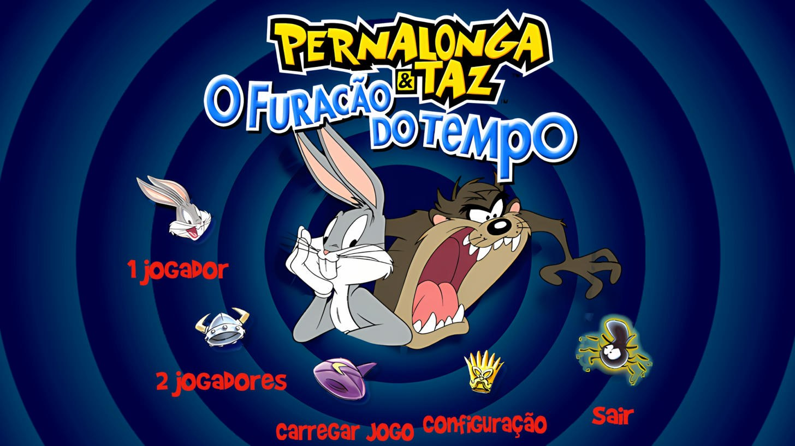

# Pacote HD dos menus (opcional)

Gera a pasta `bin\hd` que o `dinput.dll` do BBLIT2 Fix usa nos menus 2D:

- **ícones, logos e fundos ampliados 4×** com o [Real-ESRGAN](https://github.com/xinntao/Real-ESRGAN) (modelo `RealESRGAN_x4plus_anime_6B`, licença BSD-3), rodando pelo `onnxruntime`, sem PyTorch;
- **tela inicial em azul escuro**: os anéis azul-claro da tela inicial (e o pedaço de fundo que vem desenhado nos ícones dela) ganham as cores dos anéis da tela de configuração. As sombras e os brilhos continuam por cima. Para manter o azul original, use `--sem-tela-escura`.



O mod mistura cada ícone HD com o fundo já pronto, então não aparece o retângulo do ícone. As laterais 16:9 são desenhadas com os anéis medidos na própria imagem HD.

## Como gerar

```
pip install numpy scipy pillow opencv-python scikit-image onnx onnxruntime
python make_pack.py "C:\Jogos\BBLIT2\data" "C:\Jogos\BBLIT2\bin"
```

Na primeira vez o script baixa o modelo (18 MB) do GitHub do Real-ESRGAN e converte para ONNX na pasta `cache`. Leva uns 5 minutos na CPU e ocupa cerca de 100 MB.

Arquivos gerados:

| Arquivo | O que é |
|---|---|
| `bin\hd\<nome>.bmp` | a imagem 4× |
| `bin\hd\1x\<nome>.bmp` | versão 1× que substitui a original (só a tela inicial e os ícones dela, quando recoloridos) |

Para desligar sem apagar a pasta: `menu_hd=0` em `[video]` no `bblit2fix.ini`.

## HUD em HD (0.13)

O HUD da fase (silhuetas do Pernalonga e do Taz, barras de vida, ícones) vem das texturas do próprio jogo, que só existem enquanto ele roda. Por isso são duas etapas:

1. Com `hud_hd=1` em `[video]`, jogue uma fase até o HUD aparecer. O mod salva cada textura do HUD em `bin\hd\hud\fonte\<hash>.bmp`.
2. Rode o `make_pack.py` de novo. Ele amplia cada uma 4× e grava em `bin\hd\hud\<hash>.bmp`:
   - silhuetas em preto e branco são **retraçadas** (o contorno vira curva suave, sem serrilhado e sem o borrão do ESRGAN);
   - ícones coloridos vão pelo Real-ESRGAN, com o alfa ampliado à parte;
   - os degradês das barras são só ampliados.

A folha `bin\hd\hud\hud_comparacao.png` mostra cada textura original (ampliada sem suavizar) ao lado da HD. Sem a pasta `hud`, o HUD continua como antes (xBR).

| Arquivo | O que é |
|---|---|
| `bin\hd\hud\fonte\<hash>.bmp` | textura original do HUD, exportada pelo mod |
| `bin\hd\hud\<hash>.bmp` | a mesma, 4×, que o mod usa no lugar |
| `bin\hd\hud\hud_comparacao.png` | original × HD lado a lado, para conferir |

**As imagens geradas são do jogo: use no seu computador e não distribua o pacote.** Este repositório tem só os scripts.
